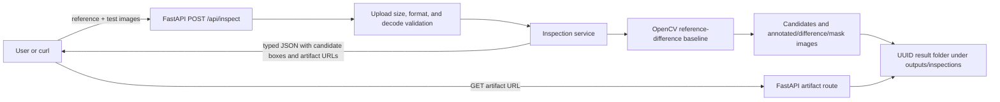

# Project Walkthrough: Phases 00–03

This guide describes what is present in the workspace, what the backend does
when it processes a pair of images, and what is still incomplete. It is based
on the source files, implementation plan, tests, and the saved API smoke-test
result. It does not claim that the system can reliably detect real PCB defects.

## At a glance

| Phase | Current status | What that means |
|---|---|---|
| 00 — Setup | Partially verified | This Linux machine has a working backend environment and a React/Vite scaffold. The second machine, webcam, and VLM setup are not verified. |
| 01 — Baseline | Baseline implemented; data validation incomplete | The OpenCV image-difference detector and synthetic demo work. Real image labels and real defect accuracy are not established. |
| 02 — Localization evaluation | Code implemented; real-data evaluation blocked | Metrics, an experimental structural detector, and evaluation tools exist. The available comparison is synthetic-only; no detector is frozen. |
| 03 — Inspection API | Implemented and smoke-tested | FastAPI accepts a reference/test pair, runs the baseline, returns candidates, and serves result images. |

**Current user path:** upload or send two images to the API → OpenCV compares
them → API returns candidate boxes and image artifacts. The React page is
still the Vite starter page and does not yet provide an inspection dashboard.

## What was checked

- Current host reports Ubuntu 26.04, Python 3.14.4, OpenCV 5.0.0, Node.js
  22.22.1, npm 9.2.0, Git 2.53.0, Intel Core i5-6300U, and about 7.1 GiB RAM.
- `GET /api/health` returned `{"status":"ok", ...}`.
- The saved synthetic API run completed with two candidates and a measured
  detector time of 49.95 ms. Its annotated-artifact endpoint returned HTTP 200.
- Backend tests: **83 passed, 4 subtests passed**. Python compilation and
  `pip check` passed.
- Frontend ESLint and Vite production build passed. This validates the current
  starter frontend, not a dashboard.
- Ollama was not found on this machine's PATH. Webcam access and a second
  teammate's setup were not tested.

The test pair in the smoke run was the generated synthetic pair. It is not a
test of real PCB defect accuracy.

## End-to-end flow



In the current workspace, the upload client that has actually been exercised
is `curl` or the interactive API docs. The frontend is not yet connected to
this flow.

## Backend processing, step by step

### 1. Receive and limit the uploads

`POST /api/inspect` accepts multipart form fields named `reference` and
`test`. The route reads each file in 64 KiB chunks and rejects an individual
file larger than 10 MiB. The optional form parameters are `threshold`
(default 25, range 0–255) and `min_area` (default 80, minimum 1).

The original upload filename is not used as a path.

### 2. Validate and decode image bytes

The service checks for non-empty bytes, recognizes JPEG or PNG by its file
signature, and decodes the bytes with OpenCV. Unsupported, empty, or
undecodable images are rejected before inspection. The decoded images are
written temporarily so the existing baseline's file-path interface can be
used; these temporary input files are removed after the request.

### 3. Load and align image sizes

The baseline loads both images with `cv2.imread`. The reference image defines
the output coordinate system. If the test image has a different width or
height, it is resized directly to the reference dimensions using
`INTER_AREA`. This is a resize, not geometric registration; different
viewpoints, rotation, or aspect ratios can still cause widespread
differences.

### 4. Preprocess each image

For both images, the baseline:

1. Converts BGR color to grayscale.
2. Applies CLAHE (clip limit 2.0, 8 × 8 tile grid) to improve local contrast.
3. Applies a 5 × 5 Gaussian blur to reduce small pixel noise.

### 5. Create a difference map and binary mask

It computes the absolute pixel-wise difference between the two preprocessed
grayscale images. A binary threshold turns pixels above the configured
threshold into white and the rest into black. The default threshold is 25.

Then it applies:

- Morphological opening with a 3 × 3 rectangular kernel to remove small
  isolated noise.
- Morphological closing with the same kernel for two iterations to join
  nearby white regions and close small gaps.

### 6. Find and filter candidate regions

OpenCV extracts external contours from the mask. Contours with area below
`min_area` (default 80 pixels) are discarded. Each remaining contour becomes a
bounding box `(x, y, width, height)` in resized-reference coordinates.

These are **suspicious image differences**, not confirmed defects. The current
algorithm does not understand PCB parts, defect categories, or whether a
change is acceptable.

### 7. Measure detector time and save artifacts

The baseline timer starts before image loading and stops after candidate
extraction. It includes image loading, resizing, preprocessing, thresholding,
morphology, and contour filtering. It excludes writing output files and does
not include frontend/network time.

The inspection service creates a unique UUID and a staging directory, runs the
baseline, validates its result, writes `result.json`, then promotes the
artifacts into:

```text
outputs/inspections/<inspection-id>/
├── annotated.jpg
├── difference.jpg
├── mask.jpg
└── result.json
```

The annotated image is the test image with red candidate boxes. The difference
image is the grayscale absolute-difference map. The mask is the final binary
mask after morphology. Uploads themselves are not retained, but generated
inspection artifacts remain on disk; there is no database, history interface,
or automatic cleanup yet.

### 8. Return JSON and serve artifacts

The response contains the inspection ID, status, detector ID, configuration,
candidate count and boxes, measured detector time, artifact URLs, and this
warning:

> Candidates indicate image differences, not confirmed defects.

The separate artifact route accepts a UUID and a known artifact name, checks
that the resolved path remains inside the configured output folder, and
returns the image or JSON file.

Expected error classes:

- **413** — uploaded image exceeds the size limit.
- **422** — invalid parameters, unsupported format, empty file, or decode
  failure.
- **404** — unknown inspection ID or artifact.
- **500** — detector or artifact-storage failure.

## Example smoke-test result

The saved response for the existing generated demo pair reports:

- Detector: `opencv_reference_difference`
- Configuration: threshold 25, minimum area 80
- Candidates: 2
- Candidate boxes: `(511, 141, 19 × 19)` and `(367, 66, 57 × 21)`
- Measured detector time: 49.95 ms
- Warning: candidates are differences, not confirmed defects

The demo generator deliberately adds a line and a circle to a simple synthetic
board. Their being highlighted verifies this one controlled software path; it
does not validate arbitrary defects or real PCBs.

## Other Phase 01–02 code that is not the API's current detector

The project also contains an experimental structural detector. It can align
images using ORB feature matching and a RANSAC homography, mask invalid warped
areas, combine intensity and Sobel-gradient differences, and return candidate
regions plus diagnostics. It is a separate experiment and is **not wired as
the API detector**; the API currently calls the original difference baseline.

Phase 02 also provides one-to-one IoU matching (initial threshold 0.3), a
dataset evaluation runner, and grouped split-generation checks. The available
synthetic comparison found both known synthetic edits for both detectors, but
there are not verified real labels or a valid held-out split. As a result:

- No detector has been selected/frozen using real validation data.
- The approved mean budget of at most five false candidates per normal image
  has not been evaluated.
- The 70% real defect-instance recall goal is **not evaluable**, not passed.

## Phase-by-phase details

### Phase 00 — Setup and hardware

**Present:** repository structure, backend virtual environment, local Python/
OpenCV, and React/Vite project scaffold. The current machine's OS, Python,
OpenCV, CPU, RAM, Node, npm, and Git versions were checked for this guide.

**Still open:** verify setup on the second teammate's machine; test webcam
capture; evaluate Ollama/VLM availability and memory on an agreed host; choose
a VLM host only after a real model test. The Ollama CLI was not available on
the current host during this check.

### Phase 01 — Baseline and dataset foundation

**Present:** image loading and resizing, grayscale/CLAHE/blur preprocessing,
difference thresholding, morphology, contour filtering, boxes, timings, JSON,
annotated images, difference images, and masks. Synthetic data and several
separate alignment/localization/preprocessing experiments are also present.

**Still open:** provenance and human-verified labels for real images, agreed
paired samples, independently reviewed annotations, and real held-out
measurements. The real-pair baseline has broad differences; without ground
truth, these cannot be called confirmed false positives or defects.

### Phase 02 — Candidate localization evaluation

**Present:** metrics, fixture tests, dataset evaluation tooling, an isolated
structural detector, and a synthetic-only comparison report.

**Still open:** compare on valid real development/validation data, select and
freeze a configuration, and run a valid held-out evaluation. Existing manifest
and split data do not currently supply the necessary verified pairs, labels,
and non-overlapping groups.

### Phase 03 — Inspection API

**Present and smoke-tested:** health endpoint, upload validation, baseline
inspection service, typed response, filesystem artifacts, and constrained
artifact retrieval. The API is stateless and has no inspection-history
database.

## Run it yourself

From the repository root, start the backend in one terminal:

```bash
cd backend
./venv/bin/uvicorn main:app --reload
```

In a second terminal, start the frontend:

```bash
cd frontend
npm run dev
```

The frontend currently displays the unmodified Vite starter, not an inspection
dashboard. For now, test the API at `http://127.0.0.1:8000/docs` or use this
command from the repository root:

```bash
curl -X POST http://127.0.0.1:8000/api/inspect \
  -F "reference=@datasets/synthetic/reference.jpg" \
  -F "test=@datasets/synthetic/test.jpg" \
  -F "threshold=25" \
  -F "min_area=80"
```

Use the returned artifact URLs to open the annotated, difference, and mask
images. From inside `backend/`, prefix the dataset paths with `../`.

## What remains before this is a fuller MVP

1. Build the Phase 04 React upload/results dashboard and connect it to the API.
2. Collect legally usable real PCB image pairs and document their board/session
   provenance.
3. Obtain human-reviewed annotations, complete normal/defect labels, and valid
   board/session-grouped development, validation, and held-out splits.
4. Compare and freeze a detector only after real validation evidence exists;
   then evaluate the held-out split once.
5. Test camera/VLM feasibility if those remain desired features. Neither VLM
   explanations, live camera capture, MQTT, nor dashboard history is currently
   implemented.

The task-by-task source of truth is the [MVP implementation plan](./mvp-implementation-plan.md).
API details are in [Phase 03 API documentation](./phase-03-api.md), and the
baseline experiment findings are in [Phase 01 results](./phase-01-results.md).
